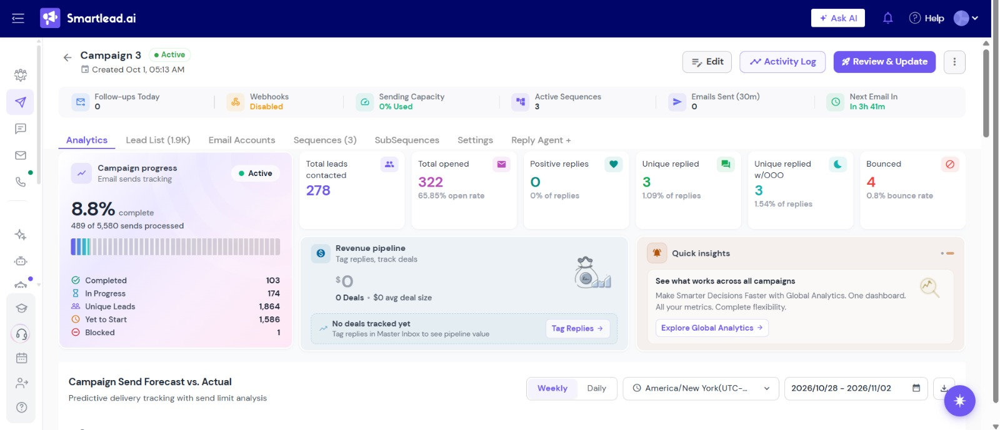
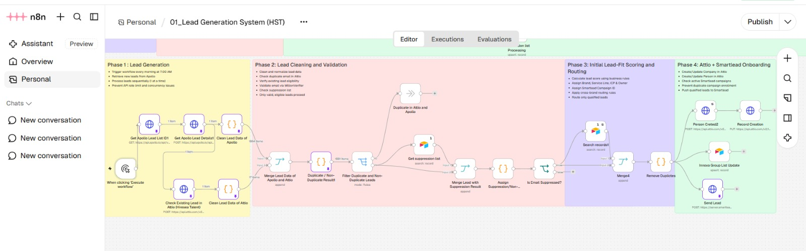
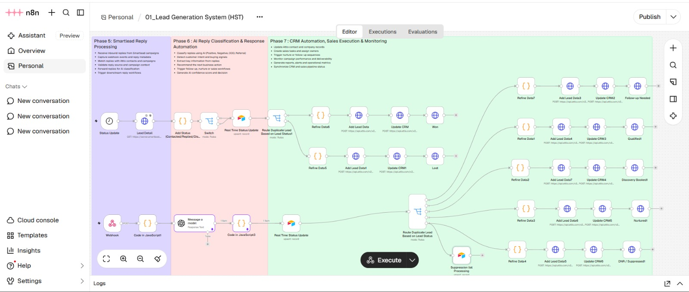

# 🚀 B2B Outbound Lead Generation & Email Automation System

---

## 📺 System Walkthrough

🎥 Watch the complete technical demonstration and automation walkthrough:

https://www.loom.com/share/52ab5a235ab04870a2ac2574c9f07ba1

---

## 🚀 Project Overview

This project is a **B2B Outbound Lead Generation and Email Outreach Automation System** that automates the journey from **ICP targeting and lead generation to email outreach, reply processing, and sales execution**.

**Apollo** is used to identify and extract targeted companies and decision-makers based on the **Ideal Customer Profile (ICP)**, while **Smartlead** manages automated outbound email campaigns and follow-ups.

**Attio** manages **CRM records, lead statuses, and sales activities**, while **Airtable** serves as the **backend database and data management layer**. All platforms are connected through automated **n8n workflows**.

---

## 📊 Campaign Analytics & Performance

The outbound email campaigns are monitored through **Smartlead Analytics**, providing visibility into campaign engagement, replies, deliverability, bounce rates, and campaign progress.

Based on the campaign analytics shown below:

- **📈 65.85% Email Open Rate**
- **💬 1.09% Reply Rate**
- **🚫 0.8% Bounce Rate**
- **📧 278 Total Leads Contacted**
- **📨 322 Total Opens**
- **💬 3 Unique Replies**

  

---

## 🏗️ Technical Specialty: Automated GTM Infrastructure

This project was designed as a connected **Go-To-Market (GTM) automation system**, integrating multiple platforms through **n8n workflows, APIs, webhooks, JavaScript logic, and AI-powered processing**.

Key technical components include:

- **Automated Lead Generation:** Extracts targeted companies and decision-makers based on ICP requirements.
- **Data Cleaning & Standardization:** Processes and structures incoming lead data.
- **Duplicate Detection:** Prevents duplicate contacts from being processed.
- **Airtable Backend Database:** Stores and manages automation data.
- **Attio CRM Integration:** Manages prospect records, lead statuses, and sales activities.
- **Smartlead Campaign Automation:** Manages outbound email campaigns and follow-ups.
- **Webhook-Based Reply Processing:** Captures prospect replies and campaign events.
- **AI Reply Classification:** Analyzes replies and determines the appropriate next action.
- **Automated Sales Routing:** Updates lead status and routes prospects based on their responses.

---

# 📝 The System Workflow

## 1️⃣ ICP Targeting & Lead Generation

The workflow begins by identifying companies and decision-makers that match the defined **Ideal Customer Profile (ICP)**.

**Apollo** is used to identify and extract targeted B2B leads based on criteria such as:

- Company type
- Industry
- Company size
- Geographic location
- Relevant decision-makers
- Job titles
- Target market

  

---

## 2️⃣ Lead Data Cleaning & Standardization

After lead extraction, incoming data is processed before moving into the rest of the automation system.

The workflow performs:

- Lead data cleaning
- Data standardization
- Field mapping
- Data transformation
- Lead information formatting

This ensures that lead information remains structured across all connected platforms.

---

## 3️⃣ Duplicate Detection & Validation

The system checks incoming leads against existing records to identify:

- Duplicate leads
- Existing contacts
- Previously processed records
- Matching email addresses

This helps prevent duplicate data and unnecessary duplicate outreach.

---

## 4️⃣ Airtable Backend Database

**Airtable** serves as the backend database and data management layer of the system.

It stores and manages:

- Lead data
- Processed records
- Automation data
- Campaign-related information
- Structured backend records

---

## 5️⃣ Attio CRM Management

Relevant prospects are synchronized with **Attio**, which manages the CRM and sales lifecycle.

Attio manages:

- Company records
- Person records
- Lead statuses
- Sales activities
- Pipeline stages
- Prospect information
- Follow-up activities

The automation workflow continuously processes and updates lead information across the connected systems.

---

## 6️⃣ Smartlead Campaign Onboarding

Qualified leads are prepared for outbound email campaigns through **Smartlead**.

The campaign infrastructure manages:

- Initial outreach emails
- Automated follow-ups
- Email sequences
- Campaign activity
- Lead status monitoring
- Reply tracking

The automation connects the lead generation process directly with the outbound campaign workflow.

---

## 7️⃣ Automated Email Outreach & Follow-Ups

The outreach system uses structured multi-step email sequences:

**Initial Email → Follow-Up 1 → Follow-Up 2**

Smartlead manages campaign activity while the automation workflow monitors and processes lead behavior.

---

## 8️⃣ Smartlead Reply Processing

When a prospect replies, the reply is captured through the automation workflow using **webhooks**.

The system processes information such as:

- Prospect details
- Reply content
- Campaign information
- Email activity
- Lead information

The reply is then passed into the AI processing workflow.

---

## 9️⃣ AI Reply Classification

AI-powered automation analyzes prospect replies and determines their intent.

Replies can be classified into categories such as:

- 🟢 Interested
- ✅ Qualified
- 📅 Discovery Booked
- 🌱 Nurtured
- ❌ Not Interested
- 🔴 Lost
- 🚫 Do Not Contact / Suppressed

This reduces the manual effort required to read and categorize prospect responses.

---

## 🔟 Automated CRM Updates & Sales Routing

Based on reply classification and lead activity, the automation updates the prospect's information and status in **Attio CRM**.

Possible outcomes include:

- 🏆 **Won**
- ✅ **Qualified**
- 📅 **Discovery Booked**
- 🌱 **Nurtured**
- ❌ **Lost**
- 🚫 **DNC / Suppressed**

  

---

# 🧠 Core Technical Pillars

- **🎯 ICP-Based Lead Generation:** Targeted companies and decision-makers are identified based on defined ICP requirements.

- **🧹 Automated Data Processing:** Lead data is cleaned, standardized, and structured automatically.

- **🔍 Duplicate Detection:** Existing contacts are identified to prevent duplicate processing.

- **🗄️ Airtable Backend Database:** Provides data storage and persistence for automation workflows.

- **👥 Attio CRM Integration:** Manages prospect records, lead statuses, and sales activities.

- **📧 Smartlead Email Outreach:** Manages multi-step campaigns and automated follow-ups.

- **🪝 Webhook Architecture:** Captures replies and campaign events for automated processing.

- **🤖 AI Reply Classification:** Automatically analyzes prospect responses and determines the next action.

- **📊 Campaign Analytics:** Tracks engagement, replies, bounce rates, and campaign progress.

---

# 🛠️ Technical Stack

| Layer | Technology |
| :--- | :--- |
| **⚙️ Workflow Automation** | **n8n** |
| **🔍 Lead Generation** | **Apollo** |
| **🧹 Data Processing** | **n8n Code Nodes / JavaScript** |
| **🗄️ Backend Database** | **Airtable** |
| **👥 CRM & Sales Management** | **Attio** |
| **📧 Email Outreach** | **Smartlead** |
| **🪝 Event Processing** | **Webhooks** |
| **🤖 AI Processing** | **AI Reply Classification** |
| **🔗 Integrations** | **REST APIs** |
| **📊 Campaign Analytics** | **Smartlead Analytics** |

---

# 🚀 Key Result

The final system connects the complete outbound process:

**Apollo Lead Generation → Data Processing → Airtable Backend Database → Attio CRM → Smartlead Email Outreach → Follow-Ups → Reply Processing → AI Classification → CRM Updates & Sales Routing**

This creates a centralized and scalable **B2B Outbound Lead Generation and GTM Automation System**.

---

## ✍️ Author

**Muneeb Ali Khan**

- **LinkedIn:** [Muneeb Ali Khan](https://www.linkedin.com/in/muneeb-ali-khan-2a1675365)
